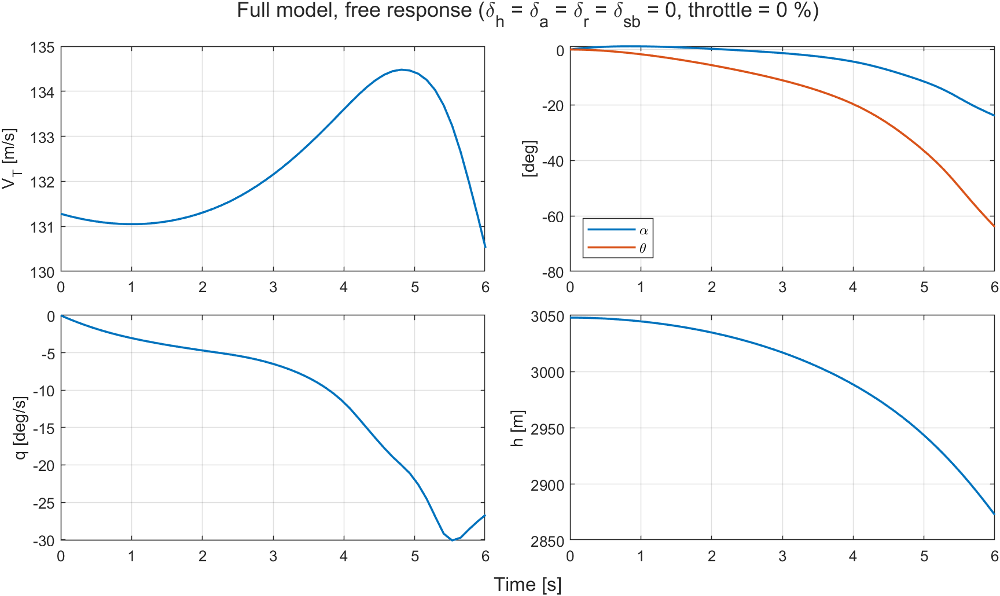

# HW-1: F-16 Plant Modeli ve Aerodinamik Katsayılar

UUM523E Advanced Flight Dynamics, İTÜ, Güz 2026 — Grup 2
Dilan Gelturan, Emirhan Oskay, Emircan Sürücü, Berat Alku

## Genel tanım

Bu çalışmada F-16'nın doğrusal olmayan, 6 serbestlik dereceli (6-DOF) plant modeli Simulink'te kuruldu. Model, ödevin istediği altı alt sistemden oluşuyor: Aerodynamics, Propulsion, Atmosphere, Mass & Inertia, Actuators ve Equations of Motion. Bunlara ek olarak kök seviyede hücum kenarı flapı tarifesi (LEF schedule) ve toplam kuvvet toplayıcısı bulunuyor. Modelin hiçbir yerinde Aerospace Blockset bloğu kullanılmadı; her alt sistem temel Simulink bloklarıyla (lookup table, gain, sum, product, integrator, saturation, switch) kuruldu.

Aerodinamik model ve motor modeli NASA TP-1538'e (Nguyen vd., 1979) dayanıyor. Standart atmosfer modeli Stevens, Lewis ve Johnson'ın *Aircraft Control and Simulation* kitabının Ek A.6'sından alındı ve İngiliz birim sisteminden SI'ya çevrildi. Aerodinamik ve motor verisi olarak dersin verdiği `f16_AerodynamicData.mat` ve `f16_EngineData.mat` dosyaları, kendi breakpoint'leriyle birlikte kullanıldı. Modelin içindeki bütün hesaplar SI birimlerinde yapılıyor; veri tablolarının İngiliz birimindeki girdi/çıktıları (irtifa ft, itki lbf) blokların içinde dönüştürülüyor.

Ödevin sonuçları (Tablo 1, Tablo 2 ve Problem 2) modelin alt sistemleri tek başına çalıştırılarak elde edildi. Bu işi `run_HW1.m` scripti yapıyor ve ödevin istediği `HW1_Group2.mat` dosyasını ve Problem 2 grafiklerini üretiyor. Altı alt sistemin birlikte çalıştığını göstermek için script, modelin tamamıyla 6 saniyelik bir serbest yanıt simülasyonu da yapıyor. Ayrıntılı anlatım ve yorumlar raporda (`HW1_Report_Group2_eng.pdf`).

## Dosyalar

| Dosya / klasör | İçerik |
|---|---|
| `HW1_Report_Group2_eng.pdf` | Rapor (depoda `homework/` klasöründe) |
| `F16_6DOF.slx` | Simulink plant modeli, **R2023a** formatında kayıtlı. Kökte 6 alt sistem, LEF tarifesi ve toplam kuvvet bloğu var. Her bölümün denklemi modelin içinde, ilgili blokların yanında yazılı. |
| `init_F16.m` | Modelin kullandığı bütün veri, sabit ve başlangıç koşullarını MATLAB çalışma alanına yükler. Model bu değişkenler olmadan çalışmaz. |
| `run_HW1.m` | Ödevin bütün sonuçlarını üretir: Tablo 1, Tablo 2, sonuç dosyası, Problem 2 grafikleri ve tam model simülasyonu. |
| `test_aero_table1.m` | Aerodynamics alt sistemini Tablo 1'in 10 durumunda çalıştırır ve sonuçları referans değerlerle karşılaştırır. |
| `test_thrust_table2.m` | Propulsion alt sistemini Tablo 2'nin 5 durumunda çalıştırır ve sonuçları referans değerlerle karşılaştırır. |
| `HW1_Group2.mat` | Sonuç dosyası. Yalnızca `AeroResults` (10×12) ve `ThrustResults` (5×1) değişkenlerini içerir. |
| `figures/` | Grafikler: `P2a_CL_CD.png`, `P2b_Cm.png`, `P2b_Cm_alpha.png`, `P1_FullModel.png` |
| `data/` | Dersin orijinal veri dosyaları. Hiç değiştirilmedi; gerekli düzeltmeler yalnızca bellekte yapılıyor. |

GitHub deposunda ayrıca kaynak PDF'ler (`Resources/`) ve karşılaştırma için kullanılan açık kaynaklı bir F-16 modeli (`reference/`) bulunuyor. Bunlar teslim paketine dahil değil ve kodun çalışması için gerekmiyor.

## Çalıştırma

Gereksinim: MATLAB ve Simulink, R2023a veya daha yeni bir sürüm. Başka bir toolbox gerekmiyor.

1. MATLAB'da bu klasörü açın (Current Folder).
2. Komut penceresine `run_HW1` yazın.

Script sırasıyla şunları yapar:

1. `init_F16`'yı çalıştırır ve modeli yükler.
2. Tablo 1'in uçuş koşulunu (0.4 Mach, 10 000 ft) atmosfer denklemleriyle hesaplar: V_T = 131.2776 m/s, q̄ = 7806.322 Pa.
3. Tablo 1'in 10 durumunu hesaplayıp `AeroResults` olarak ekrana yazar.
4. Tablo 2'nin 5 durumunu hesaplayıp `ThrustResults` olarak ekrana yazar.
5. `HW1_Group2.mat` dosyasını kaydeder.
6. Problem 2a için C_L ve C_D grafiklerini çizer.
7. Problem 2b için C_m,t ve C_m,tα grafiklerini çizer ve her β için C_m,tα > 0 olan α aralıklarını ekrana yazar.
8. Modelin tamamını 6 saniye çalıştırır (kumandalar ve gaz kolu sıfır), `P1_FullModel.png` grafiğini çizer ve t = 0, 3, 6 s değerlerini ekrana yazar.

Her α taraması tek bir simülasyonla yapıldığı için script kısa sürede biter. `F16_6DOF.slx` bu sırada değiştirilmez; hesaplar için açılan geçici test modelleri iş bitince kapatılır.

Test scriptleri (`test_aero_table1`, `test_thrust_table2`) ayrı ayrı çalıştırılabilir. Her biri sonuçları referansla karşılaştırır ve en sonda "tüm durumlar uyumlu" ya da hangi hücrede fark olduğunu yazar.

Modelin tamamını çalıştırmak için önce `init_F16`, sonra `sim('F16_6DOF')` kullanılır. Kök seviyedeki beş giriş şunlardır:

| Giriş | Anlamı | Birim |
|---|---|---|
| `dh_cmd` | Stabilatör komutu | deg |
| `da_cmd` | Kanatçık komutu | deg |
| `dr_cmd` | Dümen komutu | deg |
| `dsb_cmd` | Hava freni komutu | deg |
| `throttle` | Gaz kolu konumu | % |

Bu girişlere bir sinyal bağlanmazsa sıfır kabul edilir. Model trimli değildir: başlangıç koşulu 3048 m irtifada, gövde ekseninde 131.28 m/s ileri hızla düz uçuştur ve kumandalar sıfırdır. Trim ve doğrusallaştırma HW-2'nin konusu.

## Model yapısı

Kök seviyede alt sistemler birbirine Goto/From etiketleriyle bağlı. Sinyal akışı şöyle:

1. Kumanda komutları Actuators'a gider.
2. Actuators'ın çıkışındaki gerçek yüzey açıları Aerodynamics'e gider.
3. LEF tarifesi α ve q̄/p_s'den flap komutunu üretir. Bu komut da Actuators üzerinden Aerodynamics'e ulaşır.
4. Aerodynamics, Propulsion ve Mass & Inertia'nın kuvvetleri toplanır.
5. Toplam kuvvet ile aerodinamik moment Equations of Motion'a girer.
6. Equations of Motion'ın çıkışları (hız, açısal hız, Euler açıları, irtifa) Atmosphere'a, Aerodynamics'e, Mass & Inertia'ya ve Propulsion'a geri döner.
7. Atmosphere, hızdan ve irtifadan α, β, V_T, q̄, Mach ve p_s'yi hesaplayıp ilgili alt sistemlere dağıtır.

Kök seviyedeki etiketler:

| Etiket | Anlamı | Birim | Üreten | Kullanan |
|---|---|---|---|---|
| `V_body` | Gövde ekseninde hız [u, v, w] | m/s | EOM | Atmosphere |
| `omega_body` | Açısal hızlar [p, q, r] | rad/s | EOM | `p`, `q`, `r` olarak Aerodynamics |
| `euler_angles` | [φ, θ, ψ] | rad | EOM | Mass & Inertia |
| `altitude` | İrtifa h = −z_E | m | EOM | Atmosphere, Propulsion |
| `Positions` | Yer ekseninde konum [x, y, z] (NED) | m | EOM | — |
| `alpha`, `beta` | Hücum ve yanal kayma açısı | deg | Atmosphere | Aerodynamics, LEF |
| `TAS` | Gerçek hava hızı V_T | m/s | Atmosphere | Aerodynamics |
| `q_dyn` | Dinamik basınç q̄ | Pa | Atmosphere | Aerodynamics, LEF |
| `mach` | Mach sayısı | — | Atmosphere | Propulsion |
| `p_s` | Statik basınç | Pa | Atmosphere | LEF |
| `dlef_cmd` | LEF komutu | deg | LEF tarifesi | Actuators |
| `dh`, `da`, `dr`, `dlef`, `d_sb` | Gerçek yüzey açıları | deg | Actuators | Aerodynamics |
| `throttle` | Gaz kolu | % | kök girişi | Propulsion |
| `F_aero`, `M_aero` | Aerodinamik kuvvet ve moment | N, N·m | Aerodynamics | Toplam kuvvet, EOM |
| `F_thrust` | İtki kuvveti | N | Propulsion | Toplam kuvvet |
| `F_gravity` | Yerçekimi kuvveti | N | Mass & Inertia | Toplam kuvvet |
| `F_tot` | Toplam kuvvet | N | Toplam kuvvet | EOM |

## Alt sistemler

### Aerodynamics

**Görevi.** Uçağa etki eden aerodinamik kuvvet ve momentleri gövde ekseninde hesaplar. Momentler ağırlık merkezi etrafında (x_cg = 0.35c̄) alınır.

**Girdiler.** Port sırasıyla: α, β, δh, δlef, q, δsb, δa, δr, r, p, x_cg, q̄, S, b, c̄, V_T. Açılar derece, açısal hızlar rad/s, x_cg c̄'nin kesri olarak girer.

**Çıktılar.** **F**_A = [X, Y, Z] (N) ve **M**_A = [L, M, N] (N·m).

**Yapısı.** Önce açısal hızlar boyutsuz hâle getirilir: c̄/(2V_T) ve b/(2V_T) hesaplanır. Sonra altı katsayı alt sistemi (CX, CY, CZ, Cl, Cm, Cn) çalışır. En sonda katsayılar kuvvet ve momente çevrilir:

- **F**_A = q̄S [C_X, C_Y, C_Z]
- **M**_A = q̄S [b·C_l, c̄·C_m, b·C_n]

Katsayılar TP-1538'in yapı taşı (build-up) denklemleriyle hesaplanır. Aşağıda Λ = 1 − δlef/25 ve C(α, β, 0), δh = 0 dilimi anlamına gelir.

**C_X ve C_Z** (boyuna kuvvetler; i = X veya Z):

C_i,t = C_i(α, β, δh) + ΔC_i,lef·Λ + (c̄q / 2V_T)[C_iq(α) + ΔC_iq,lef(α)·Λ] + ΔC_i,sb(α)·δsb/60

ΔC_i,lef = C_i,lef(α, β) − C_i(α, β, 0)

**C_Y** (yanal kuvvet):

C_Y,t = C_Y(α, β) + ΔC_Y,lef·Λ + [ΔC_Y,δa + ΔC_Y,δa,lef·Λ]·δa/20 + ΔC_Y,δr·δr/30 + (b / 2V_T){r[C_Yr(α) + ΔC_Yr,lef(α)·Λ] + p[C_Yp(α) + ΔC_Yp,lef(α)·Λ]}

**C_l ve C_n** (yuvarlanma ve sapma momenti; i = l veya n). Bunlar C_Y ile aynı yapıda, ayrıca iki terim içerir:

- β'ya bağlı ek terim: ΔC_iβ(α)·β
- C_n'de ağırlık merkezi kayması: −C_Y,t·(x_cg,ref − x_cg)·c̄/b

**C_m** (yunuslama momenti; ödevdeki formülün aynısı):

C_m,t = C_m(α, β, δh)·η_δh(δh) + (c̄q / 2V_T)[C_mq(α) + ΔC_mq,lef(α)·Λ] + C_Z,t(x_cg,ref − x_cg) + ΔC_m,lef·Λ + ΔC_m,sb(α)·δsb/60 + ΔC_m(α) + ΔC_m,ds(α, δh)

Yanal katsayılardaki fark terimleri şöyle tanımlıdır:

- ΔC_lef = C_lef(α, β) − C(α, β, 0)
- ΔC_δa = C_δa=20(α, β) − C(α, β, 0)
- ΔC_δa,lef = C_δa=20,lef(α, β) − C_lef(α, β) − ΔC_δa
- ΔC_δr = C_δr=30(α, β) − C(α, β, 0)

C_Y'de taban tablo δh'ye bağlı değildir; orada C(α, β, 0) yerine C_Y(α, β) kullanılır.

**Kullanılan tablolar.** Hepsi `AeroData.<katsayı>.<tablo>` adıyla modele bağlı.

| Katsayı | Tablolar |
|---|---|
| CX | `CX` (α, β, δh), `CXlef`, `CXq`, `deltaCXqlef`, `deltaCXSB` |
| CY | `CY`, `CYlef`, `CYda20`, `CYda20lef`, `CYdr30`, `CYr`, `deltaCYrlef`, `CYp`, `deltaCYplef` |
| CZ | `CZ` (α, β, δh), `CZlef`, `CZq`, `deltaCZqlef`, `deltaCZSB` |
| Cl | `Cl` (α, β, δh), `Cllef`, `Clda20`, `Clda20lef`, `Cldr30`, `Clr`, `deltaClrlef`, `Clp`, `deltaClplef`, `deltaClBeta` |
| Cm | `Cm` (α, β, δh), `n_dHT` (η_δh), `Cmlef`, `Cmq`, `deltaCmqlef`, `deltaCm`, `deltaCmds`, `deltaCmSB` |
| Cn | `Cn` (α, β, δh), `Cnlef`, `Cnda20`, `Cnda20lef`, `Cndr30`, `Cnr`, `deltaCnrlef`, `Cnp`, `deltaCnplef`, `deltaCnBeta` |

**Tabloların aralığı:**
- Ana tablolar: α = −20…90° (20 nokta), β = −30…30° (19 nokta).
- δh boyutu: CX, CZ ve Cm'de −25…25° (5 nokta), Cl ve Cn'de −25, 0, 25°.
- LEF tabloları (`*lef`): yalnızca α = −20…45°.

Bütün tablolar doğrusal ara değerlenir. Tablo sınırının dışında değer sınırda sabit tutulur (Clip).

### Propulsion

**Görevi.** Gaz kolu konumundan motorun itkisini hesaplar. Motorun güce gecikmeli tepkisi de modele dahildir.

**Girdiler.** Gaz kolu δ_th (%), Mach, irtifa (m).

**Çıktı.** **F**_T = [T, 0, 0] (N). İtki gövde x ekseni boyunca etki eder; motor momenti yoktur.

**Yapısı.** Dört adımdan oluşur.

1. **Gaz dişlisi.** Gaz kolu konumu güç komutuna P_c çevrilir. %0–77 aralığı P_c = 0–50 (military güce kadar), %77–100 aralığı P_c = 50–100 (afterburner) aralığına doğrusal olarak eşlenir.

2. **Motor dinamiği** (Engine Dynamics alt sistemi). Gerçek güç seviyesi P_3, Ṗ_3 = (1/τ)(P_2 − P_3) denklemine göre değişir. Hedef güç P_2 ve zaman sabiti τ şu kurallarla seçilir:

   | Durum | P_2 | 1/τ |
   |---|---|---|
   | P_c ≥ 50 ve P_3 ≥ 50 | P_c | 5 s⁻¹ |
   | P_c ≥ 50 ve P_3 < 50 | 60 | R_τ(P_2 − P_3) |
   | P_c < 50 ve P_3 ≥ 50 | 40 | 5 s⁻¹ |
   | P_c < 50 ve P_3 < 50 | P_c | R_τ(P_2 − P_3) |

   R_τ(ΔP) = 1.0 (ΔP ≤ 25), 1.9 − 0.036ΔP (25 < ΔP < 50), 0.1 (ΔP ≥ 50).

   Bunun sonucu şu: motor rölantiden yavaş toparlanır. Güç 50'yi geçip afterburner bölgesine girince çok hızlı tepki verir. Başlangıç değeri P_3(0) = `P3_0`'dır.

3. **İtki ara değerlemesi.** Idle, military ve maximum itki tabloları Mach'a (0–1) ve irtifaya (0–50 000 ft) bağlıdır. Güç seviyesine göre ara değerlenir:
   - T = T_idle + (T_mil − T_idle)·P_3/50 (P_3 ≤ 50)
   - T = T_mil + (T_max − T_mil)·(P_3 − 50)/50 (P_3 > 50)

4. **Birim dönüşümü.** Tablolar irtifayı ft cinsinden okuyor ve itkiyi lbf cinsinden veriyor. İrtifa girişte metreden ft'ye, itki çıkışta N'ye çevrilir.

### Atmosphere

**Görevi.** Standart atmosferi ve hava verilerini hesaplar.

**Girdiler.** İrtifa h (m), gövde hızı **V**_B = [u, v, w] (m/s).

**Çıktılar.** V_T (m/s), α (deg), β (deg), q̄ (Pa), Mach, p_s (Pa).

**Denklemler.** Stevens–Lewis–Johnson Ek A.6, SI'ya çevrilmiş hâli:

- Toplam hız: V_T = √(u² + v² + w²); sıfıra bölmeyi önlemek için en az 0.1 m/s.
- Hücum açısı: α = atan2(w, u).
- Yanal kayma açısı: β = asin(v / V_T); asin'in argümanı ±1'e sınırlanır.
- Sıcaklık oranı: T* = 1 − k·h.
- Sıcaklık: T = T₀·T* (h ≤ h_tp), T = T_tp (h > h_tp).
- Yoğunluk: ρ = ρ₀·(T*)^4.14.
- Mach: M = V_T / √(γRT).
- Dinamik basınç: q̄ = ½ρV_T².
- Statik basınç: p_s = R·ρ·T.

**Sabitler** (`init_F16`'da İngiliz biriminden çevrilmiş değerler):

| Sabit | Değer |
|---|---|
| ρ₀ | 1.22506 kg/m³ |
| k | 2.30643·10⁻⁵ 1/m |
| T₀ | 288.333 K |
| T_tp (tropopozdaki sıcaklık) | 216.667 K |
| h_tp (tropopoz) | 10 668 m (35 000 ft) |
| γR | 401.813 m²/(s²·K) |
| R (basınç için) | 286.792 J/(kg·K) |

### Mass & Inertia

**Görevi.** Yerçekimi kuvvetini gövde eksenine geçirir.

**Girdi.** Euler açıları φ, θ. ψ kullanılmaz, çünkü yerçekiminin gövdeye göre dağılımı uçağın yönüne bağlı değildir.

**Çıktı.** **F**_G (N).

**Denklem.** **F**_G = W [−sinθ, sinφ·cosθ, cosφ·cosθ]

**Kütle ve atalet** (TP-1538 Tablo I, `init_F16`):

| Büyüklük | İngiliz birimi | SI |
|---|---|---|
| Ağırlık W | 20 500 lbf | 91 188.6 N (m = 9298.64 kg) |
| Kanat alanı S | 300 ft² | 27.8709 m² |
| Kanat açıklığı b | 30 ft | 9.144 m |
| Ortalama veter c̄ | 11.32 ft | 3.45034 m |
| I_xx | 9 496 slug·ft² | 12 874.8 kg·m² |
| I_yy | 55 814 slug·ft² | 75 673.6 kg·m² |
| I_zz | 63 100 slug·ft² | 85 552.1 kg·m² |
| I_xz | 982 slug·ft² | 1 331.41 kg·m² |
| Motor açısal momentumu H_e | 160 slug·ft²/s | 216.931 kg·m²/s |
| x_cg, x_cg,ref | 0.35c̄ | 0.35c̄ |

### Actuators

**Görevi.** Kumanda yüzeylerinin komuta gecikmeli ve fiziksel sınırlar içinde gitmesini sağlar.

**Girdiler.** δh, δa, δr, δlef ve δsb komutları (deg).

**Çıktılar.** Gerçek yüzey açıları (deg).

**Denklem.** Stabilatör, kanatçık, dümen ve hücum kenarı flapı birinci mertebe sistemlerdir:

δ̇ = sat_hız[(sat_konum(δ_c) − δ) / τ]

Komut önce konum sınırına kırpılır. Hata τ'ya bölünerek yüzeyin hızı bulunur, bu hız da hız sınırına kırpılıp integrali alınır. Hava freninde dinamik yoktur; komut yalnızca konum sınırından geçer.

| Kanal | Konum sınırı | Hız sınırı | τ |
|---|---|---|---|
| Stabilatör δh | −25…25° | 60°/s | 0.0495 s |
| Kanatçık δa | −21.5…21.5° | 80°/s | 0.0495 s |
| Dümen δr | −30…30° | 120°/s | 0.0495 s |
| Hücum kenarı flapı δlef | 0…25° | 25°/s | 0.136 s |
| Hava freni δsb | 0…60° | — | — |

### Equations of Motion

**Görevi.** Kuvvet ve momentlerden uçağın hareketini bulur.

**Girdiler.** Toplam kuvvet **F** = **F**_A + **F**_T + **F**_G (N), aerodinamik moment **M**_A (N·m).

**Çıktılar.** **V**_B (m/s), ω = [p, q, r] (rad/s), Euler açıları (rad), konum (m), irtifa (m).

**Yapısı.** Alt sistemin içi beş bölüme ayrılmış:

| Bölüm | Denklem |
|---|---|
| Inputs | **V**_B, ω ve Euler açılarını bileşenlerine ayırır |
| Translational Dynamics | u̇ = F_x/m + rv − qw,  v̇ = F_y/m + pw − ru,  ẇ = F_z/m + qu − pv |
| Rotational Dynamics | ω̇ = I⁻¹[**M** − ω × **H** − ω × **h**_e], **H** = Iω, **h**_e = [H_e, 0, 0] |
| Rotational Kinematics | φ̇ = p + (q sinφ + r cosφ) tanθ,  θ̇ = q cosφ − r sinφ,  ψ̇ = (q sinφ + r cosφ)/cosθ |
| Translational Kinematics | Gövde hızı sırayla φ, θ, ψ kadar döndürülerek yere göre hız bulunur. Bunun integrali konumu verir; irtifa h = −z_E |

Atalet matrisi Ixz çarpımını içerir: I = [I_xx, 0, −I_xz; 0, I_yy, 0; −I_xz, 0, I_zz].

Başlangıç koşulları `init_F16`'dadır:
- **V**_B(0) = [131.28, 0, 0] m/s
- ω(0) = 0
- Euler açıları = 0
- Konum = [0, 0, −3048] m

Euler açılarıyla yazıldığı için θ = ±90°'de kinematik denklem tekildir.

### LEF tarifesi ve toplam kuvvet

**LEF tarifesi.** Hücum kenarı flapının komutunu α'ya ve q̄/p_s oranına göre üretir. Komut, Actuators'ın flap kanalına gider:

δlef = 1.38·(2s + 7.25)/(s + 7.25)·α − 9.05·q̄/p_s + 1.45

- (2s + 7.25)/(s + 7.25) bir ön-geri filtresidir: kararlı hâlde kazancı 1'dir, ani α değişimlerinde 2'ye çıkar.
- q̄/p_s oranı Mach'ın karesiyle orantılıdır, (γ/2)M². Hız arttıkça flap toplanır.
- Ödevin istediği gibi Tablo 1 hesaplarında bu tarife kullanılmaz; δlef tablodan doğrudan verilir.

**Toplam kuvvet.** Aerodinamik, itki ve yerçekimi kuvvetleri gövde ekseninde toplanır: **F** = **F**_A + **F**_T + **F**_G.

## Doğrulama

Ödev, aerodinamik alt sistemin Tablo 1'deki 10 durum ve motor alt sisteminin Tablo 2'deki 5 durum için doğrulanmasını istiyor. Her durumda katsayıların, kuvvet ve momentlerin ya da kararlı hâl itkisinin hesaplanıp ortak bir dosya düzeninde teslim edilmesi isteniyor; böylece bütün grupların sonuçları doğrudan karşılaştırılabilecek.

**Aerodinamik doğrulama (Tablo 1).**
- `run_HW1`, modeldeki Aerodynamics bloğunun bir kopyasını geçici bir test modeline koyar. Tablodaki girişleri verir ve çıkışları okur; yani sonuçlar doğrudan modelin kendi alt sisteminden gelir.
- Uçuş koşulu atmosfer denklemlerinden hesaplanır: 0.4 Mach, 10 000 ft → V_T = 131.2776 m/s, q̄ = 7806.322 Pa.
- Tablodaki p, q, r değerleri deg/s'den rad/s'ye çevrilir.
- δlef tablodan doğrudan verilir; LEF tarifesi kullanılmaz.
- Katsayılar kuvvet ve momentlerden geri hesaplanır: C_X = X/(q̄S), C_l = L/(q̄Sb), C_m = M/(q̄Sc̄).
- Sonuç `AeroResults` (10×12): sütunlar C_X, C_Y, C_Z, C_l, C_m, C_n, X, Y, Z, L, M, N.

**Motor doğrulaması (Tablo 2).**
- Propulsion bloğunun bir kopyası her durum için tek başına çalıştırılır.
- Ödev kararlı hâl itkisini istediği için motor, başlangıçta o gaz konumunun kararlı gücünde başlatılır (P_3(0) = P_c). Böylece motor gecikmesi sonucu etkilemez.
- Sonuç `ThrustResults` (5×1, N).

**Sonuç dosyası.** İki değişken ödevin istediği sıra ve boyutta, double olarak `HW1_Group2.mat`'a kaydedilir. Dosyada başka değişken yoktur.

**Ek kontrol.** İki test scripti aynı hesabı yapıp sonuçları referans değerlerle karşılaştırır. Referans değerler, geliştirme sırasında aynı ders verisi ve TP-1538 denklemleriyle, modelden bağımsız olarak hesaplanıp scriptlere yazıldı. Bütün durumlar referansla aynı çıkıyor:

| Kontrol | Tolerans | En büyük fark |
|---|---|---|
| Tablo 1, katsayılar (10 durum) | 10⁻⁶ | 3.3·10⁻¹² |
| Tablo 1, kuvvet ve momentler (10 durum) | 10⁻² N, N·m | 3.3·10⁻⁶ |
| Tablo 2, itki (5 durum) | 10⁻² N | 4.8·10⁻⁷ N |

## Sonuçlar

### Tablo 1: Aerodinamik doğrulama

Durumların girişleri (açılar deg, açısal hızlar deg/s):

| Durum | α | β | p | q | r | δa | δh | δr | δlef | δsb |
|:-:|--:|--:|--:|--:|--:|--:|--:|--:|--:|--:|
| 1 | 0 | 0 | 0 | 0 | 0 | 0 | 0 | 0 | 0 | 0 |
| 2 | 0 | 0 | 0 | 0 | 0 | 0 | 0 | 0 | 0 | 60 |
| 3 | 20 | 0 | 0 | 0 | 0 | 0 | 0 | 0 | 0 | 0 |
| 4 | 0 | 12.5 | 0 | 0 | 0 | 0 | 0 | 0 | 0 | 0 |
| 5 | 0 | 0 | 0 | 0 | 0 | 0 | −15 | 0 | 0 | 0 |
| 6 | 0 | 0 | 0 | 0 | 0 | 0 | 0 | 0 | 25 | 0 |
| 7 | 0 | 0 | 0 | 0 | 0 | 10 | 0 | 0 | 0 | 0 |
| 8 | 0 | 0 | 0 | 0 | 0 | 0 | 0 | −15 | 0 | 0 |
| 9 | 5.16 | 0 | 0 | 0 | 0 | 0 | −0.47 | 0 | 7.55 | 0 |
| 10 | 5.95 | 0 | −0.53 | 1.21 | 2.09 | −0.055 | −0.62 | −0.33 | 8.65 | 0 |

Katsayılar:

| Durum | C_X | C_Y | C_Z | C_l | C_m | C_n |
|:-:|--:|--:|--:|--:|--:|--:|
| 1 | −0.020200 | 0 | −0.100000 | 0 | −0.007700 | 0 |
| 2 | −0.030300 | 0 | −0.485800 | 0 | −0.011100 | 0 |
| 3 | 0.022100 | 0 | −1.355000 | 0 | 0.023900 | 0 |
| 4 | −0.015200 | −0.267700 | −0.106500 | −0.018200 | −0.006600 | 0.051200 |
| 5 | −0.050167 | 0 | 0.019333 | 0 | 0.127733 | 0 |
| 6 | −0.048900 | 0 | −0.025000 | 0 | −0.040800 | 0 |
| 7 | −0.020200 | 0.010450 | −0.100000 | −0.025600 | −0.007700 | −0.004950 |
| 8 | −0.020200 | −0.041050 | −0.100000 | −0.007250 | −0.007700 | 0.022550 |
| 9 | −0.003960 | 0 | −0.417217 | 0 | 0.000061 | 0 |
| 10 | 0.000621 | 0.000193 | −0.478558 | 0.000287 | 0.000054 | 0.000033 |

Kuvvetler ve momentler:

| Durum | X [N] | Y [N] | Z [N] | L [N·m] | M [N·m] | N [N·m] |
|:-:|--:|--:|--:|--:|--:|--:|
| 1 | −4394.90 | 0 | −21756.93 | 0 | −5780.29 | 0 |
| 2 | −6592.35 | 0 | −105695.17 | 0 | −8332.63 | 0 |
| 3 | 4808.28 | 0 | −294806.41 | 0 | 17941.42 | 0 |
| 4 | −3307.05 | −58243.30 | −23171.13 | −36208.06 | −4954.54 | 101860.03 |
| 5 | −10914.73 | 0 | 4206.34 | 0 | 95887.78 | 0 |
| 6 | −10639.14 | 0 | −5439.23 | 0 | −30628.04 | 0 |
| 7 | −4394.90 | 2273.60 | −21756.93 | −50930.02 | −5780.29 | −9847.80 |
| 8 | −4394.90 | −8931.22 | −21756.93 | −14423.54 | −5780.29 | 44862.18 |
| 9 | −861.66 | 0 | −90773.72 | 0 | 45.84 | 0 |
| 10 | 135.14 | 42.05 | −104119.59 | 571.22 | 40.39 | 65.40 |

Tablodan okunabilen bazı noktalar:
- Durum 6'da δlef = 25°, yani Λ = 0'dır ve LEF fark terimleri sıfırlanır. Sonuç doğrudan taban tablolardan gelir.
- Durum 1'de δlef = 0, yani Λ = 1'dir ve LEF fark terimleri tam ağırlıkla girer.
- Durum 5'teki negatif δh (−15°) burnu yukarı kaldıran büyük bir yunuslama momenti üretir: C_m = 0.1277.

### Tablo 2: İtki doğrulaması

| Durum | Mach | İrtifa [ft] | Gaz kolu [%] | Güç komutu P_c [%] | İtki [N] | İtki [lbf] |
|:-:|:-:|--:|--:|--:|--:|--:|
| 1 | 0.25 | 5000 | 10.00 | 6.49 | 7891.80 | 1774.15 |
| 2 | 0.65 | 25000 | 77.00 | 50.00 | 26867.26 | 6040.00 |
| 3 | 0.90 | 45000 | 95.00 | 89.13 | 24059.66 | 5408.83 |
| 4 | 0.40 | 10000 | 16.66 | 10.82 | 9049.33 | 2034.37 |
| 5 | 0.40 | 10000 | 19.77 | 12.84 | 10717.85 | 2409.47 |

Durum 2'de gaz kolu tam military noktasında (%77 → P_c = 50); itki doğrudan military tablosundan gelir. Durum 3'te gaz kolu afterburner bölgesindedir (P_c > 50); itki military ile maximum arasında ara değerlenir.

### Problem 2a: Kaldırma ve sürükleme katsayıları

Beş koşulda α = −20…90° aralığı 0.5° adımla tarandı. Açısal hızlar sıfır, uçuş koşulu Tablo 1 ile aynı. Gövde eksenindeki katsayılar rüzgâr eksenine çevrildi:

C_L = C_X sinα − C_Z cosα
C_D = −C_X cosα cosβ − C_Y sinβ − C_Z sinα cosβ

| Koşul | β | δh | δlef | δsb |
|:-:|:-:|:-:|:-:|:-:|
| i | 0 | 0 | 0 | 0 |
| ii | 0 | 0 | 0 | 60 |
| iii | 0 | 0 | 25 | 0 |
| iv | 15 | 0 | 0 | 0 |
| v | 0 | −25 | 0 | 0 |

- **Temel durum (i).** C_L, α ile neredeyse doğrusal artıyor ve en yüksek değerine (yaklaşık 1.72) α ≈ 35°'de ulaşıyor. Bu noktadan sonra stall nedeniyle düşüyor ve α = 90°'de sıfıra yaklaşıyor. C_D en küçük değerini α ≈ 0°'da alıyor (yaklaşık 0.020); α arttıkça hızla büyüyerek α = 90°'de 2.2'ye ulaşıyor.
- **Hava freni (ii, δsb = 60°).** Düşük α'da kaldırmayı artırıyor; α = 0°'da C_L 0.10'dan 0.49'a çıkıyor. Ancak C_L'nin en yüksek değeri 1.59'a düşüyor. Sürükleme artıyor; α = 20°'de C_D yaklaşık 0.24 daha büyük. Hava freninin asıl amacı da sürüklemeyi artırmak.
- **Hücum kenarı flapı (iii, δlef = 25°).** C_L'nin en yüksek değerini yaklaşık 1.89'a çıkarıyor. Flap kanadın ön kenarında akışın ayrılmasını geciktirdiği için yüksek α'da daha fazla kaldırma elde ediliyor. α = 20°'de sürükleme azalıyor, düşük α'da biraz artıyor.
- **Yanal kayma (iv, β = 15°).** C_L'nin en yüksek değeri yaklaşık 1.57'ye düşüyor. C_D düşük α'da tabandan büyük (α = 0°'da +0.076); bunun bir kısmı C_Y sinβ teriminden geliyor. Yüksek α'da tabandan küçük.
- **Stabilatör (v, δh = −25°).** Stabilatörün negatif açısı kuyrukta aşağı yönde kuvvet üretiyor. Bu yüzden α 45°'nin altındayken C_L tabandan küçük (α = 0°'da −0.18) ve en yüksek değeri 1.50'ye düşüyor. C_D negatif α'da büyük, yüksek α'da küçük.

Grafiklerdeki 45° çizgisi LEF tablolarının bittiği noktayı gösterir (bkz. Veri notları).

### Problem 2b: Yunuslama momenti ve statik kararlılık

C_m,t, ödevin verdiği formülle 9 β değeri (−30, −15, −10, −6, 0, 6, 10, 15, 30°) için hesaplandı. Koşullar:
- x_cg = x_cg,ref = 0.35c̄; ağırlık merkezi terimi sıfır.
- δh = δlef = δsb = 0, q = 0.

C_m,tα = ∂C_m,t/∂α, α = −20…60° aralığında merkezi farkla hesaplandı ve 1/deg cinsinden verildi. Tablolar 5°'lik noktalar arasında doğrusal ara değerlendiği için türev basamaklı görünür.

C_m,tα < 0 olduğunda α artınca burnu aşağı indiren bir moment oluşur ve uçak boyuna yönde statik olarak kararlıdır. C_m,tα > 0 ise kararsızdır. Her β için kararsız α aralıkları:

| β [deg] | C_m,tα > 0 olan α aralıkları [deg] |
|:-:|---|
| −30 | 25…35, 40…50, 55…60 |
| −15 | −20…−15, −4.5…14.5, 35.5…50, 55…60 |
| −10 | −14.5…15, 40…50, 55…60 |
| −6 | −14.5…15, 25.5…30, 35.5…50, 55…60 |
| 0 | −14.5…15, 35.5…50, 55…60 |
| 6 | −14.5…15, 40…50, 55…60 |
| 10 | −14.5…15, 40…50, 55…60 |
| 15 | −14.5…−10.5, −5…14.5, 35.5…50, 55…60 |
| 30 | 25…34.5, 40…50, 55…60 |

- **β = 0.** Uçak yaklaşık −15° < α < 15° aralığında statik olarak kararsız. TP-1538'in incelediği "gevşetilmiş boyuna statik kararlılık" durumu bu. F-16 bu ağırlık merkezi konumunda (0.35c̄) kendi başına kararsız; bu bölgede kararlılığı uçuş kontrol sistemi sağlar. α = 15–35° arası kararlı, 35–50° arası yeniden kararsız, 50–55° arası kararlı, 55–60° arası kararsız.
- **β'nın etkisi.** |β| ≤ 10° için eğriler birbirine yakın ve kararsız bölgeler büyük ölçüde aynı. |β| = 15°'de düşük α'daki kararsız bölge ikiye bölünüyor. |β| = 30°'de düşük α'daki kararsızlık ortadan kalkıyor, ama yüksek α'daki kararsızlık daha erken, α = 25° civarında başlıyor. Yani büyük yanal kaymada uçak düşük α'da daha kararlı, orta α'da daha kararsız.
- **β = −6° eğrisi.** α = 20–30° arasındaki çukur ve C_m,tα'daki sıçrama, tablodaki tek bir veri noktasından geliyor (bkz. Veri notları); aerodinamik bir etki değil. β = +6°'daki simetrik eğride bu çukur yok.

### Tam model: serbest yanıt

Modelin tamamı 6 saniye çalıştırıldı. Kumandalar sıfır, gaz kolu %0; başlangıç koşulu V_T = 131.28 m/s, α = θ = 0, h = 3048 m. Model trimli olmadığı için amaç bir uçuş koşulunu doğrulamak değil, altı alt sistemin birlikte sayısal sorun çıkarmadan çalıştığını ve fiziksel olarak beklenen yönde tepki verdiğini göstermek.

Kumandalar sıfırken yunuslama momenti burun aşağı yönde olduğu için uçak burnunu indiriyor. Uçak küçük α'da statik olarak kararsız olduğundan hareket sönmek yerine büyüyor: t = 6 s'de θ yaklaşık −64°, α yaklaşık −24° ve irtifa kaybı yaklaşık 175 m. Simülasyon, θ'nın −90°'ye ulaştığı ve Euler açılarının tekil olduğu t ≈ 7 s'den önce bitiyor.

## Veri notları

- **C_lp, α = 55°.** Ders verisinde −1200 yazıyor. TP-1538 Tablo III'te bu değer −0.12; komşu değerler −0.10 ve −0.14. Bu açıkça bir yazım hatası. `init_F16` değeri bellekte −0.12 olarak düzeltiyor ve ekrana bir not yazıyor; veri dosyası değiştirilmedi. Tablo 1'deki durumlar α = 55°'yi kullanmadığı için sonuçları etkilemiyor.
- **C_m,lef, α = 25°, β = −6°.** Değer −0.1607. Komşu noktalar −0.0648 (β = −8°) ve −0.0558 (β = −4°), β = +6°'daki simetrik karşılığı −0.0530. Aynı değer TP-1538 Tablo III'te de bulunuyor (s. 64); yani ders verisi orijinali doğru aktarmış, ama değer büyük olasılıkla orijinal rapordaki bir baskı hatası. Ödev verilen verinin kullanılmasını istediği için değer olduğu gibi bırakıldı. Yalnızca Problem 2b'deki β = −6° eğrisini etkiliyor.
- **LEF tablolarının aralığı.** LEF tabloları (`*lef`, `delta*lef`) yalnızca α = −20…45° aralığında tanımlı; ana tablolar −20…90°'yi kapsıyor. 45°'nin üstünde lookup'lar sınır değerini kullandığı için LEF katkısı 45°'deki değerinde sabit kalıyor. Bu, verinin bir sınırı ve grafiklerde 45° çizgisiyle işaretlendi.

## Kabuller

- **Birimler.** Modelin içinde SI kullanılıyor. Açılar ve kumanda yüzeyleri derece, açısal hızlar rad/s. Dönüşümler için 1 ft = 0.3048 m, 1 lbf = 4.448222 N kullanıldı (ödevin istediği değerler). g = 9.80665 m/s².
- **Eksenler.** Kuvvet ve momentler gövde ekseninde. Momentler x_cg = 0.35c̄ etrafında alınıyor. Konum NED ekseninde, irtifa h = −z_E.
- **LEF katkısı.** Λ = 1 − δlef/25 ile ölçekleniyor (TP-1538 ve ödevin C_m,t formülü). δlef = 25°'de Λ = 0 olur ve LEF fark terimleri sıfırlanır.
- **Ara değerleme.** Bütün tablolar doğrusal ara değerleniyor; tablo sınırının dışında son değer korunuyor.
- **Problem 2.** Açısal hızlar sıfır, uçuş koşulu Tablo 1 ile aynı (0.4 Mach, 10 000 ft). C_L ve C_D gövde eksenindeki katsayılardan rüzgâr eksenine dönüşümle bulunuyor. C_m,tα, 0.5° aralıklı C_m,t değerlerinden sayısal türevle (1/deg) hesaplanıyor.
- **Motor.** İtki gövde x ekseni boyunca etki ediyor; itkinin ağırlık merkezine göre momenti yok. Motorun açısal momentumu H_e sabit alınıyor.
- **Eyleyiciler.** Başlangıç açıları sıfır. Kumanda komutları önce konum sınırına kırpılıyor.

## Kaynaklar

- L. T. Nguyen, M. E. Ogburn, W. P. Gilbert, K. S. Kibler, P. W. Brown, P. L. Deal, *Simulator Study of Stall/Post-Stall Characteristics of a Fighter Airplane With Relaxed Longitudinal Static Stability*, NASA TP-1538, 1979.
- B. L. Stevens, F. L. Lewis, E. N. Johnson, *Aircraft Control and Simulation: Dynamics, Controls Design, and Autonomous Systems*, 3. baskı, Wiley, 2016.

Depodaki `reference/bhattacharya-f16/` karşılaştırma modeli © 2023 Raktim Bhattacharya, MIT Lisansı.
