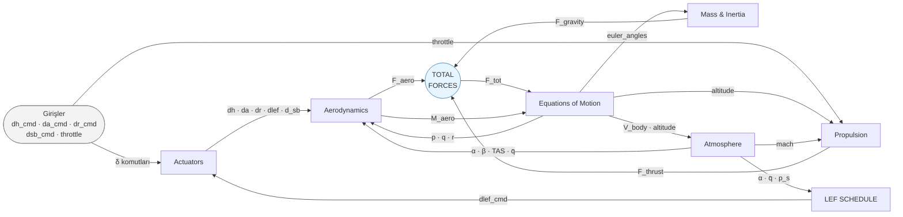
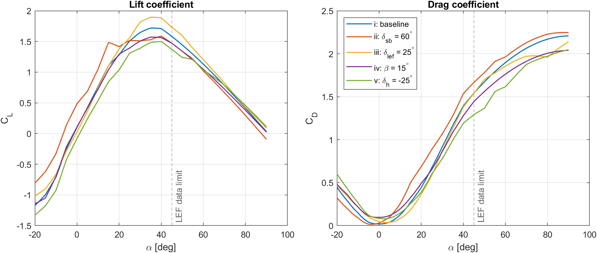
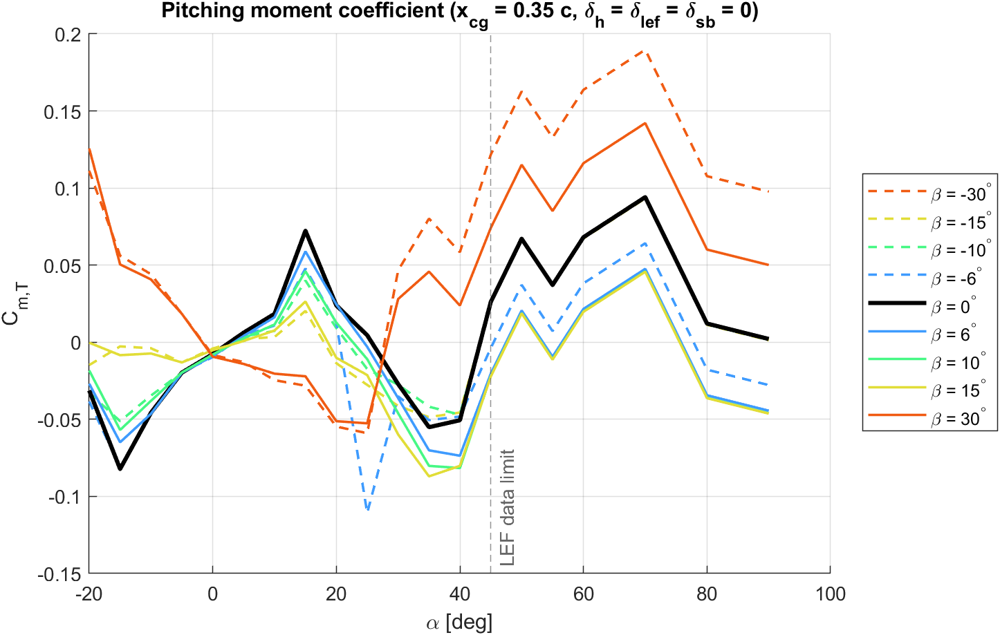
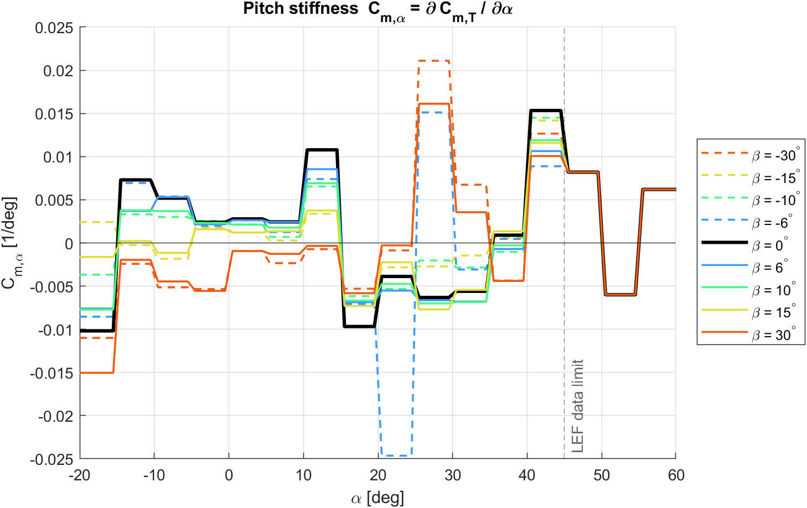

<div align="center">

# HW-1 · F-16 Plant Model and Aerodynamic Coefficients

**UUM523E Advanced Flight Dynamics · İTÜ · Güz 2026 · Grup 2**

Dilan Gelturan · Emirhan Oskay · Emircan Sürücü · Berat Alku


</div>

F-16'nın doğrusal olmayan 6 serbestlik dereceli plant modeli, Aerospace Blockset kullanılmadan Simulink'te kuruldu. Aerodinamik model NASA TP-1538'e, atmosfer modeli Stevens–Lewis–Johnson Ek A.6'ya dayanıyor; atmosfer SI birimlerine çevrildi. Bu depo modeli, onu çalıştıran kodu ve ödevin istediği bütün sonuçları içeriyor.

## İçindekiler

1. [Hızlı başlangıç](#1-hızlı-başlangıç)
2. [Dosyalar](#2-dosyalar)
3. [Model](#3-model)
4. [Adım adım çalıştırma](#4-adım-adım-çalıştırma)
5. [Sonuçlar](#5-sonuçlar)
6. [Veri notları](#6-veri-notları)
7. [Birimler ve kabuller](#7-birimler-ve-kabuller)

---

## 1. Hızlı başlangıç

MATLAB'da bu klasörü açıp tek komut çalıştırın:

```matlab
run_HW1
```

Birkaç saniye içinde şunlar üretilir:

| Çıktı | İçerik |
|---|---|
| Komut penceresi | Tablo 1 ve Tablo 2 sonuçları, Problem 2b kararlılık özeti |
| `HW1_Group2.mat` | `AeroResults` (10×12) ve `ThrustResults` (5×1); başka değişken yok |
| `figures/P2a_CL_CD.png` | Problem 2a: C<sub>L</sub> ve C<sub>D</sub> – α |
| `figures/P2b_Cm.png` | Problem 2b: C<sub>m,t</sub> – α (9 β) |
| `figures/P2b_Cm_alpha.png` | Problem 2b: C<sub>m,tα</sub> – α (9 β) |

**Gereksinimler:** MATLAB ve Simulink. Başka toolbox gerekmez; Aerospace Blockset gerekmez.

---

## 2. Dosyalar

| Dosya | Görevi |
|---|---|
| [`F16_6DOF.slx`](F16_6DOF.slx) | Simulink plant modeli (6 alt sistem) |
| [`init_F16.m`](init_F16.m) | Bütün parametreleri ve veri tablolarını çalışma alanına yükler (SI) |
| [`run_HW1.m`](run_HW1.m) | Ödevin bütün sonuçlarını üretir: Tablo 1, Tablo 2, `.mat` dosyası, Problem 2 grafikleri |
| [`test_aero_table1.m`](test_aero_table1.m) | Aerodynamics alt sistemini Tablo 1'de bağımsız referansla karşılaştırır |
| [`test_thrust_table2.m`](test_thrust_table2.m) | Propulsion alt sistemini Tablo 2'de bağımsız referansla karşılaştırır |
| [`HW1_Group2.mat`](HW1_Group2.mat) | Sonuç dosyası |
| [`figures/`](figures/) | Problem 2 grafikleri |
| [`data/`](data/) | Dersin orijinal veri dosyaları (`f16_AerodynamicData.mat`, `f16_EngineData.mat`); hiç değiştirilmedi |
| [`Resources/`](Resources/) | NASA TP-1538 ve ilgili kaynak PDF'ler |

---

## 3. Model

### 3.1 Sinyal akışı

Kök seviyede alt sistemler birbirine Goto/From etiketleriyle bağlı. Alt sistemlerin içinde her bölümün denklemi, ilgili blokların yanında yazılı.



### 3.2 Alt sistemler

| Alt sistem | Ne hesaplar | Temel denklem | Kaynak |
|---|---|---|---|
| **Aerodynamics** | 6 katsayı alt sistemi (CX, CY, CZ, Cl, Cm, Cn) ve gövde eksenindeki kuvvet/moment | **F**<sub>A</sub> = q̄S [C<sub>X</sub> C<sub>Y</sub> C<sub>Z</sub>]ᵀ, **M**<sub>A</sub> = q̄S [b·C<sub>l</sub>  c̄·C<sub>m</sub>  b·C<sub>n</sub>]ᵀ | TP-1538 Ek B |
| **Propulsion** | Gaz dişlisi, motor güç dinamiği, idle/mil/max ara değerlemesi | Ṗ<sub>3</sub> = (1/τ)(P<sub>2</sub> − P<sub>3</sub>); **F**<sub>T</sub> = [T 0 0]ᵀ | TP-1538 Şekil 66 |
| **Atmosphere** | Standart atmosfer (SI) ve hava verisi | T* = 1 − kh, ρ = ρ<sub>0</sub>(T*)<sup>4.14</sup>, M = V<sub>T</sub>/√(γRT), q̄ = ½ρV<sub>T</sub>² | SLJ Ek A.6 |
| **Mass & Inertia** | Gövde eksenindeki yerçekimi kuvveti | **F**<sub>G</sub> = W [−sinθ, sinφ cosθ, cosφ cosθ]ᵀ | — |
| **Actuators** | 4 kanal birinci mertebe + konum ve hız sınırı; hava freni yalnız konum sınırı | δ̇ = sat<sub>δ̇max</sub>[(sat<sub>δ</sub>(δ<sub>c</sub>) − δ)/τ] | TP-1538 |
| **Equations of Motion** | Öteleme/dönme dinamiği, Euler kinematiği, navigasyon | **V̇**<sub>B</sub> = **F**/m − ω×**V**<sub>B</sub>, ω̇ = I⁻¹[**M** − ω×(Iω + **h**<sub>e</sub>)] | — |
| **LEF SCHEDULE** (kök alanı) | Hücum kenarı flapı komutu | δ<sub>lef</sub> = 1.38·(2s + 7.25)/(s + 7.25)·α − 9.05·q̄/p<sub>s</sub> + 1.45 | TP-1538 |

Aerodinamik katsayıların tam açılımı (Λ = 1 − δ<sub>lef</sub>/25, q̂ = c̄q/2V<sub>T</sub>), örneğin yunuslama momenti:

C<sub>m,t</sub> = C<sub>m</sub>(α,β,δ<sub>h</sub>)·η<sub>δh</sub>(δ<sub>h</sub>) + C<sub>Z,t</sub>(x<sub>cg,ref</sub> − x<sub>cg</sub>) + ΔC<sub>m,lef</sub>·Λ + q̂[C<sub>mq</sub>(α) + ΔC<sub>mq,lef</sub>(α)·Λ] + ΔC<sub>m</sub>(α) + ΔC<sub>m,ds</sub>(α,δ<sub>h</sub>) + ΔC<sub>m,sb</sub>(α)·δ<sub>sb</sub>/60

Diğer beş katsayının denklemi, modelde ilgili alt sistemin (`Aerodynamics/CX` … `Cn`) içinde yazılı.

### 3.3 Eyleyici sınırları

| Kanal | Konum [deg] | Hız sınırı [deg/s] | τ [s] |
|---|---|---|---|
| δ<sub>h</sub> (stabilatör) | [−25, 25] | 60 | 0.0495 |
| δ<sub>a</sub> (kanatçık) | [−21.5, 21.5] | 80 | 0.0495 |
| δ<sub>r</sub> (dümen) | [−30, 30] | 120 | 0.0495 |
| δ<sub>lef</sub> (hücum kenarı flapı) | [0, 25] | 25 | 0.136 |
| δ<sub>sb</sub> (hava freni) | [0, 60] | — | — |

### 3.4 Motor modeli

Gaz kolu konumu δ<sub>th</sub> [%] önce güç komutuna çevrilir: δ<sub>th</sub> = %77'de military (P<sub>c</sub> = 50), %100'de maksimum güç (P<sub>c</sub> = 100). Gerçek güç seviyesi P<sub>3</sub>, bu komuta TP-1538'deki gecikme kurallarıyla yaklaşır:

| Durum | P<sub>2</sub> (hedef) | 1/τ |
|---|---|---|
| P<sub>c</sub> ≥ 50, P<sub>3</sub> ≥ 50 | P<sub>c</sub> | 5 s⁻¹ |
| P<sub>c</sub> ≥ 50, P<sub>3</sub> < 50 | 60 | R<sub>τ</sub>(P<sub>2</sub> − P<sub>3</sub>) |
| P<sub>c</sub> < 50, P<sub>3</sub> ≥ 50 | 40 | 5 s⁻¹ |
| P<sub>c</sub> < 50, P<sub>3</sub> < 50 | P<sub>c</sub> | R<sub>τ</sub>(P<sub>2</sub> − P<sub>3</sub>) |

R<sub>τ</sub>(ΔP) = 1.0 (ΔP ≤ 25), 1.9 − 0.036ΔP (25 < ΔP < 50), 0.1 (ΔP ≥ 50). İtki P<sub>3</sub> ile idle/mil/max tablolarından ara değerlenir; tablolar Mach ve irtifaya (ft) bağlıdır.

---

## 4. Adım adım çalıştırma

### Adım 1 — Parametreler: `init_F16`

`run_HW1` ve testler bu dosyayı kendileri çağırır; modeli elle açıp çalıştıracaksanız önce bunu çalıştırın.

- `data/` içindeki ders verisini yükler: `AeroData`, `AeroBP`, `EngData`, `EngBP`.
- Birim dönüşümleri: 1 ft = 0.3048 m, 1 lbf = 4.448222 N.
- Atmosfer sabitlerini SI'ya çevirir (SLJ Ek A.6).
- Kütle, geometri, atalet (TP-1538 Tablo I): W = 20 500 lbf, S = 300 ft², b = 30 ft, c̄ = 11.32 ft, x<sub>cg</sub> = x<sub>cg,ref</sub> = 0.35c̄, I<sub>xx</sub>, I<sub>yy</sub>, I<sub>zz</sub>, I<sub>xz</sub>, H<sub>e</sub> = 160 slug·ft²/s.
- Başlangıç koşulları: V = 131.28 m/s, h = 3048 m; P<sub>3</sub>(0) = `P3_0`.
- Gaz dişlisi (`thr_BP` → `P1_tab`) ve motor zaman sabiti tablosu (`dP_BP` → `inv_tauT_tab`).
- Veri düzeltmesi: C<sub>lp</sub>(α = 55°) yalnızca bellekte düzeltilir ([§6](#6-veri-notları)).

### Adım 2 — Sonuçlar: `run_HW1`

| Bölüm | Ne yapar |
|---|---|
| Uçuş koşulu | 0.4 Mach, 10 000 ft için V<sub>T</sub> = 131.2776 m/s ve q̄ = 7806.322 Pa hesaplanır |
| 1. Tablo 1 | Modeldeki **Aerodynamics** alt sistemi geçici bir test modeline kopyalanır, 10 durum tek simülasyonda çalıştırılır (her zaman adımı bir durum). Kuvvet ve momentlerden katsayılar geri hesaplanır. Ödevin istediği gibi δ<sub>lef</sub> tablodan doğrudan verilir; LEF tarifesi kullanılmaz. |
| 2. Tablo 2 | Modeldeki **Propulsion** alt sistemi 5 durumda t = 0'da çalıştırılır. Motor kararlı hâlde başlatılır (P<sub>3</sub>(0) = P<sub>c</sub>); böylece sonuç kararlı hâl itkisidir. |
| 3. Sonuç dosyası | `save('HW1_Group2.mat','AeroResults','ThrustResults')` |
| 4. Problem 2a | α = −20…90° (0.5° adım) 5 koşulda taranır. C<sub>L</sub> = C<sub>X</sub> sinα − C<sub>Z</sub> cosα, C<sub>D</sub> = −C<sub>X</sub> cosα cosβ − C<sub>Y</sub> sinβ − C<sub>Z</sub> sinα cosβ |
| 5. Problem 2b | 9 β için C<sub>m,t</sub> hesaplanır (x<sub>cg</sub> = 0.35c̄, δ<sub>h</sub> = δ<sub>lef</sub> = δ<sub>sb</sub> = 0, q = 0). C<sub>m,tα</sub> = ∂C<sub>m,t</sub>/∂α, α = −20…60°'de merkezi farkla alınır [1/deg]. |

`F16_6DOF.slx` bu süreçte değiştirilmez; test modelleri iş bitince kapatılır.

### Adım 3 — Doğrulama: `test_aero_table1`, `test_thrust_table2`

İki test, alt sistemlerin sonucunu modelden bağımsız bir referansla karşılaştırır. Referans, aynı ders verisi ve TP-1538 denklemleriyle Python'da (SciPy, doğrusal ara değerleme) ayrıca hesaplandı.

| Test | Tolerans | En büyük fark | Sonuç |
|---|---|---|---|
| Tablo 1 – katsayılar | 10⁻⁶ | 3.3·10⁻¹² | ✅ 10/10 |
| Tablo 1 – kuvvet/moment | 10⁻² N, N·m | 3.3·10⁻⁶ | ✅ 10/10 |
| Tablo 2 – itki | 10⁻² N | 4.8·10⁻⁷ | ✅ 5/5 |

### Adım 4 — Modelin tamamını çalıştırmak (isteğe bağlı)

Ödev 6-DOF simülasyonu istemiyor, ama model tam bağlı ve çalışır durumda:

```matlab
init_F16
open_system('F16_6DOF')
out = sim('F16_6DOF', 'StopTime', '1');
```

Kök seviyedeki 5 giriş (`dh_cmd`, `da_cmd`, `dr_cmd`, `dsb_cmd` [deg] ve `throttle` [%]) bağlanmazsa sıfır kabul edilir. Model trimli değildir; başlangıç koşulu düz uçuş hızıdır.

---

## 5. Sonuçlar

### 5.1 Tablo 1 — Aerodinamik doğrulama (`AeroResults`)

Uçuş koşulu: 0.4 Mach, 10 000 ft (V<sub>T</sub> = 131.2776 m/s, q̄ = 7806.322 Pa), x<sub>cg</sub> = 0.35c̄.

| Durum | Değişen giriş | C<sub>X</sub> | C<sub>Y</sub> | C<sub>Z</sub> | C<sub>l</sub> | C<sub>m</sub> | C<sub>n</sub> |
|:-:|---|--:|--:|--:|--:|--:|--:|
| 1 | — (hepsi 0) | −0.020200 | 0 | −0.100000 | 0 | −0.007700 | 0 |
| 2 | δ<sub>sb</sub> = 60° | −0.030300 | 0 | −0.485800 | 0 | −0.011100 | 0 |
| 3 | α = 20° | 0.022100 | 0 | −1.355000 | 0 | 0.023900 | 0 |
| 4 | β = 12.5° | −0.015200 | −0.267700 | −0.106500 | −0.018200 | −0.006600 | 0.051200 |
| 5 | δ<sub>h</sub> = −15° | −0.050167 | 0 | 0.019333 | 0 | 0.127733 | 0 |
| 6 | δ<sub>lef</sub> = 25° | −0.048900 | 0 | −0.025000 | 0 | −0.040800 | 0 |
| 7 | δ<sub>a</sub> = 10° | −0.020200 | 0.010450 | −0.100000 | −0.025600 | −0.007700 | −0.004950 |
| 8 | δ<sub>r</sub> = −15° | −0.020200 | −0.041050 | −0.100000 | −0.007250 | −0.007700 | 0.022550 |
| 9 | α = 5.16°, δ<sub>h</sub> = −0.47°, δ<sub>lef</sub> = 7.55° | −0.003960 | 0 | −0.417217 | 0 | 0.000061 | 0 |
| 10 | karışık (Tablo 1) | 0.000621 | 0.000193 | −0.478558 | 0.000287 | 0.000054 | 0.000033 |

| Durum | X [N] | Y [N] | Z [N] | L [N·m] | M [N·m] | N [N·m] |
|:-:|--:|--:|--:|--:|--:|--:|
| 1 | −4 394.90 | 0 | −21 756.93 | 0 | −5 780.29 | 0 |
| 2 | −6 592.35 | 0 | −105 695.17 | 0 | −8 332.63 | 0 |
| 3 | 4 808.28 | 0 | −294 806.41 | 0 | 17 941.42 | 0 |
| 4 | −3 307.05 | −58 243.30 | −23 171.13 | −36 208.06 | −4 954.54 | 101 860.03 |
| 5 | −10 914.73 | 0 | 4 206.34 | 0 | 95 887.78 | 0 |
| 6 | −10 639.14 | 0 | −5 439.23 | 0 | −30 628.04 | 0 |
| 7 | −4 394.90 | 2 273.60 | −21 756.93 | −50 930.02 | −5 780.29 | −9 847.80 |
| 8 | −4 394.90 | −8 931.22 | −21 756.93 | −14 423.54 | −5 780.29 | 44 862.18 |
| 9 | −861.66 | 0 | −90 773.72 | 0 | 45.84 | 0 |
| 10 | 135.14 | 42.05 | −104 119.59 | 571.22 | 40.39 | 65.40 |

### 5.2 Tablo 2 — İtki doğrulaması (`ThrustResults`)

| Durum | Mach | İrtifa [ft] | Gaz kolu [%] | P<sub>c</sub> [%] | İtki [N] | İtki [lbf] |
|:-:|:-:|--:|--:|--:|--:|--:|
| 1 | 0.25 | 5 000 | 10.00 | 6.49 | 7 891.80 | 1 774.15 |
| 2 | 0.65 | 25 000 | 77.00 | 50.00 | 26 867.26 | 6 040.00 |
| 3 | 0.90 | 45 000 | 95.00 | 89.13 | 24 059.66 | 5 408.83 |
| 4 | 0.40 | 10 000 | 16.66 | 10.82 | 9 049.33 | 2 034.37 |
| 5 | 0.40 | 10 000 | 19.77 | 12.84 | 10 717.85 | 2 409.47 |

Durum 2'de gaz kolu tam military noktasında (%77 → P<sub>c</sub> = 50); itki doğrudan military tablosundan gelir.

### 5.3 Problem 2a — Kaldırma ve sürükleme katsayıları



| Koşul | Grafikte görülen etki |
|---|---|
| i. taban (β = δ<sub>h</sub> = δ<sub>lef</sub> = δ<sub>sb</sub> = 0) | C<sub>L,max</sub> ≈ 1.72, α ≈ 35–40°'de; C<sub>D</sub> en küçük değerine α ≈ 0°'da iner |
| ii. δ<sub>sb</sub> = 60° | Düşük α'da C<sub>L</sub> artar (α = 0°'da ≈ +0.45), C<sub>L,max</sub> ≈ 1.5–1.6'ya düşer; α ≳ 5°'te sürükleme tabandan belirgin şekilde büyüktür |
| iii. δ<sub>lef</sub> = 25° | Hücum kenarı flapı C<sub>L,max</sub>'ı ≈ 1.9'a çıkarır (α ≈ 35°) |
| iv. β = 15° | C<sub>L,max</sub> ≈ 1.57'ye düşer; α ≈ 0°'da C<sub>D</sub> tabandan büyük, α ≳ 35°'te küçüktür |
| v. δ<sub>h</sub> = −25° | Kuyruk aşağı yönde kuvvet ürettiği için α ≲ 45°'te C<sub>L</sub> tabandan küçüktür; C<sub>D</sub> negatif α'da büyük, yüksek α'da küçüktür |

### 5.4 Problem 2b — Yunuslama momenti ve statik kararlılık





C<sub>m,tα</sub> > 0 olan bölgeler boyuna yönde **statik olarak kararsızdır**:

| β [deg] | C<sub>m,tα</sub> > 0 olan α aralıkları [deg] |
|:-:|---|
| −30 | [25, 35], [40, 50], [55, 60] |
| −15 | [−20, −15], [−4.5, 14.5], [35.5, 50], [55, 60] |
| −10 | [−14.5, 15], [40, 50], [55, 60] |
| −6 | [−14.5, 15], [25.5, 30], [35.5, 50], [55, 60] |
| 0 | [−14.5, 15], [35.5, 50], [55, 60] |
| 6 | [−14.5, 15], [40, 50], [55, 60] |
| 10 | [−14.5, 15], [40, 50], [55, 60] |
| 15 | [−14.5, −10.5], [−5, 14.5], [35.5, 50], [55, 60] |
| 30 | [25, 34.5], [40, 50], [55, 60] |

- x<sub>cg</sub> = 0.35c̄'de uçak düşük α'da (≈ −15…15°) **gevşetilmiş statik kararlılık** gösterir: C<sub>m,tα</sub> > 0. TP-1538'in incelediği durum da budur; bu bölgede uçuş kontrol sisteminin kararlılığı sağlaması gerekir.
- β = 0'da α ≈ 15–35° ve 50–55° arası kararlı; α ≈ 35–50° ve 55–60° yeniden kararsız.
- |β| ≤ 10° için eğriler birbirine yakın; |β| = 30°'de düşük α'daki kararsızlık kaybolur, yüksek α'daki kararsızlık başlangıcı 25°'e iner.
- β = −6° eğrisindeki α ≈ 20–30° sıçraması tek bir veri noktasından gelir ([§6](#6-veri-notları)); aerodinamik bir etki değildir.

---

## 6. Veri notları

| Konu | Durum | Ne yapıldı |
|---|---|---|
| C<sub>lp</sub>(α = 55°) | Ders verisinde **−1200**; TP-1538 Tablo III'te **−0.12** (komşular −0.10, −0.14) | `init_F16` bellekte −0.12 yapar; veri dosyası değiştirilmez. Tablo 1 sonuçlarını etkilemez. |
| C<sub>m,lef</sub>(α = 25°, β = −6°) | Ders verisinde ve TP-1538 Tablo III'te **−0.1607**; komşuları ≈ −0.06, β = +6°'daki karşılığı −0.0530 | Muhtemelen orijinal rapordaki bir baskı hatası. Değer, verildiği gibi kullanıldı; yalnızca Problem 2b'deki β = −6° eğrisini etkiler. |
| LEF tabloları | Yalnızca α = −20…45° aralığında tanımlı (ana tablolar −20…90°) | Bütün lookup'lar sınır dışında **Clip** kullanır; 45°'nin üstünde LEF katkısı 45°'deki değerinde kalır. Grafiklerde 45° çizgisiyle işaretli. |

---

## 7. Birimler ve kabuller

| Büyüklük | Birim / kabul |
|---|---|
| Uzunluk, hız, kuvvet, moment | m, m/s, N, N·m (SI) |
| α, β, kumanda yüzeyleri | deg |
| p, q, r | rad/s (Tablo 1'deki deg/s değerleri çevrilir) |
| Eksenler | Kuvvet ve momentler gövde ekseninde; momentler x<sub>cg</sub> = 0.35c̄ etrafında |
| LEF katkısı | Λ = 1 − δ<sub>lef</sub>/25 ile ölçeklenir (TP-1538 ve ödev formülü) |
| Ara değerleme | Bütün tablolar doğrusal, sınır dışında Clip |
| Konum | NED; irtifa h = −z<sub>E</sub> |

---

<sub>Kaynaklar: Nguyen vd., *NASA TP-1538*, 1979 · Stevens, Lewis, Johnson, *Aircraft Control and Simulation*, 3. baskı, Wiley, 2016. `reference/bhattacharya-f16/` klasöründeki karşılaştırma modeli © 2023 Raktim Bhattacharya, [MIT Lisansı](LICENSE).</sub>
